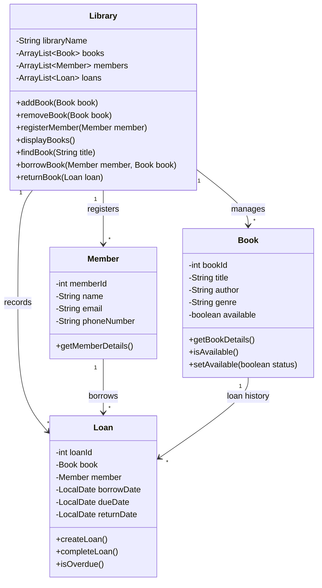

# 📚 Library Management System

## 🎯 Project Overview

A beginner-friendly Library Management System built using Java. This project is designed to develop practical programming skills and strengthen my understanding of fundamental Java concepts and Object-Oriented Programming (OOP).

The system will simulate a simple library, allowing users to manage books, register members and keep track of borrowing and returning activities.

The project will initially use a console-based interface and Java collections for data storage. No databases or advanced frameworks will be required.

## 🎯 Project Objectives

By completing this project, I aim to:

- Develop a better understanding of Java syntax and programming fundamentals.
- Learn how to design and implement classes and objects.
- Understand the four main principles of OOP.
- Practise working with collections, particularly ArrayLists.
- Understand how different classes interact with each other.
- Develop problem-solving skills by implementing features independently.
- Gain experience organising a Java project using Git and GitHub.

## ⚙️ Final System Requirements

By the end of the project, the system should allow a user to:

1. View all books in the library.
2. Add new books to the library.
3. Remove books from the library.
4. Search for books by title or author.
5. Register new library members.
6. View registered members.
7. Borrow available books.
8. Return borrowed books.
9. View borrowing records.
10. Identify overdue books.

## 🏗️ Class Diagram

The following UML class diagram illustrates the proposed structure of the system and how the different classes interact.

mermaid

## 📖 Class Descriptions

### 1\. Book.java

Represents an individual book stored in the library.

**Attributes:**

- `bookId` – Unique ID for each book.
- `title` – Title of the book.
- `author` – Author of the book.
- `genre` – Category or genre of the book.
- `available` – Indicates whether the book is available to borrow.

**Methods:**

- `getBookDetails()` – Displays book information.
- `isAvailable()` – Checks whether the book is available.
- `setAvailable()` – Updates the book's availability.

### 2\. Member.java

Represents a registered library member.

**Attributes:**

- `memberId` – Unique ID for each member.
- `name` – Member's full name.
- `email` – Member's email address.
- `phoneNumber` – Member's contact number.

**Methods:**

- `getMemberDetails()` – Displays member information.

### 3\. Loan.java

Represents a borrowing transaction between a member and a book.

**Attributes:**

- `loanId` – Unique ID for each borrowing transaction.
- `book` – The book being borrowed.
- `member` – The member borrowing the book.
- `borrowDate` – Date the book was borrowed.
- `dueDate` – Expected return date.
- `returnDate` – Actual date the book was returned.

**Methods:**

- `createLoan()` – Creates a new borrowing record.
- `completeLoan()` – Records the return of a book.
- `isOverdue()` – Checks whether the book is overdue.

### 4\. Library.java

The main management class responsible for coordinating the library's operations.

**Attributes:**

- `libraryName` – Name of the library.
- `books` – ArrayList containing all books.
- `members` – ArrayList containing registered members.
- `loans` – ArrayList containing borrowing records.

**Methods:**

- `addBook()` – Adds a book to the collection.
- `removeBook()` – Removes a book.
- `registerMember()` – Registers a new member.
- `displayBooks()` – Displays all books.
- `findBook()` – Searches for a book.
- `borrowBook()` – Handles book borrowing.
- `returnBook()` – Handles book returns.

### 5\. Main.java

The entry point of the application.

Responsible for starting the program, displaying the menu, accepting user input and interacting with the Library class.

---

# 📝 Development Roadmap & Learning Tasks

The project should be completed in the following stages. Each stage introduces new concepts and builds upon the previous one.

The objective is not just to make the system work, but to understand the Java concepts used to build it.

## Phase 1 – Java Fundamentals & Project Setup

**Learning objectives:** Java syntax, variables, data types, methods and basic program structure.

- [x]Create a new Java project in IDE.
- [x]Create a GitHub repository for the project.
- [x]Create the `Main.java` class.
- [x]Print a welcome message for the Library Management System.
- [x]Practise declaring variables using different data types.
- [x]Practise using `if`, `else` and `switch` statements.
- [x]Practise using `for` and `while` loops.
- [x]Create simple methods and call them from `Main`.

**Milestone:** A working Java program that displays a welcome message and a basic menu.

## Phase 2 – Introduction to Classes & Objects

**Learning objectives:** Classes, objects, attributes, constructors and methods.

- [x] Create the `Book.java` class.
- [x] Define the book attributes (ID, title, author, genre and availability).
- [x] Create a constructor to initialise a Book object.
- [x] Create getters and setters for the attributes.
- [x] Create a method to display the book's details.
- [x] Create multiple Book objects in `Main.java`.
- [x] Print the details of each book.
- [x] Create the `Member.java` class.
- [x] Define member attributes and create a constructor.
- [x] Create getters, setters and a method to display member details.
- [x] Create multiple Member objects and test them.

**Milestone:** You can create and manipulate Book and Member objects independently.

## Phase 3 – Encapsulation & Object-Oriented Programming

**Learning objectives:** Access modifiers, encapsulation and data protection.

- [x] Make all class attributes `private`.
- [x] Understand the difference between `private` and `public`.
- [x] Implement getters and setters.
- [x] Understand why direct access to object attributes should be restricted.
- [x] Add basic validation to setters where appropriate.
- [x] Experiment with modifying object attributes through public methods.

**Milestone:** Your Book and Member classes follow basic encapsulation principles.

## Phase 4 – Collections & ArrayLists

**Learning objectives:** Java Collections, ArrayLists and iteration.

- [ ] Learn what an ArrayList is and why it is useful.
- [ ] Create an `ArrayList<Book>`.
- [ ] Add multiple Book objects to the ArrayList.
- [ ] Display all books using a loop.
- [ ] Remove a book from the collection.
- [ ] Search for a book by its ID or title.
- [ ] Create an `ArrayList<Member>`.
- [ ] Add, remove and display members.
- [ ] Practise using `.add()`, `.remove()`, `.get()`, `.size()` and `.contains()`.

**Milestone:** You can store, retrieve, search and remove multiple objects using ArrayLists.

## Phase 5 – Building the Library Class

**Learning objectives:** Object relationships, composition and managing collections.

- [ ] Create the `Library.java` class.
- [ ] Add the library name as an attribute.
- [ ] Create ArrayLists to store books, members and loans.
- [ ] Create a constructor to initialise the library.
- [ ] Implement `addBook()`.
- [ ] Implement `removeBook()`.
- [ ] Implement `registerMember()`.
- [ ] Implement `displayBooks()`.
- [ ] Implement `findBook()`.
- [ ] Test all methods from `Main.java`.

**Milestone:** The Library class can manage its own collection of books and members.

## Phase 6 – Borrowing & Returning Books

**Learning objectives:** Object references, class relationships, LocalDate and business logic.

- [ ] Create the `Loan.java` class.
- [ ] Understand how one class can contain objects of another class.
- [ ] Add Book and Member attributes to Loan.
- [ ] Add loan ID, borrow date, due date and return date.
- [ ] Learn how to use Java's `LocalDate` class.
- [ ] Create a constructor for Loan.
- [ ] Implement `createLoan()`.
- [ ] Implement `completeLoan()`.
- [ ] Implement `isOverdue()`.
- [ ] Implement `borrowBook()` in Library.
- [ ] Prevent users from borrowing unavailable books.
- [ ] Update a book's availability when borrowed.
- [ ] Implement `returnBook()` in Library.
- [ ] Update availability when a book is returned.
- [ ] Store all borrowing records in the loans ArrayList.

**Milestone:** Members can successfully borrow and return books, and the system keeps track of each transaction.

## Phase 7 – Console Menu & User Interaction

**Learning objectives:** Scanner, switch statements, loops and program flow.

- [ ] Import and understand the Scanner class.
- [ ] Create a menu that displays available operations.
- [ ] Allow users to select an option.
- [ ] Use a switch statement to handle menu selections.
- [ ] Connect each menu option to the appropriate Library method.
- [ ] Use a loop to keep the program running until the user exits.
- [ ] Handle invalid menu selections.
- [ ] Handle invalid IDs and missing books or members.
- [ ] Test the complete system through the console.

**Milestone:** The Library Management System is fully usable through a console-based menu.

## Phase 8 – Testing & Improvements

**Learning objectives:** Debugging, validation, edge cases and code quality.

- [ ] Test adding multiple books.
- [ ] Test registering multiple members.
- [ ] Test searching for books that exist and do not exist.
- [ ] Test borrowing an available book.
- [ ] Test attempting to borrow an unavailable book.
- [ ] Test returning a borrowed book.
- [ ] Test attempting to return a book that has already been returned.
- [ ] Test overdue book detection.
- [ ] Prevent duplicate book and member IDs.
- [ ] Refactor repetitive code where appropriate.
- [ ] Add comments where they help explain your logic.

**Milestone:** The system works reliably and handles common user errors.

---

## 🏁 Final Project Checklist

The project is considered complete when:

- [ ] All five Java classes have been implemented.
- [ ] Books can be added, removed, displayed and searched.
- [ ] Members can be registered and displayed.
- [ ] Members can borrow and return books.
- [ ] Borrowing records are maintained.
- [ ] Overdue books can be identified.
- [ ] The console menu supports all main operations.
- [ ] Basic validation and error handling are implemented.
- [ ] The project runs successfully without errors.

## 🔮 Future Improvements (Optional)

After completing the core project, consider extending the system:

- Implement borrowing limits for members.
- Introduce late return fines.
- Save information to files so data persists after closing the application.
- Introduce a database using JDBC.
- Develop a graphical user interface.

## 🛠️ Technologies

- **Language:** Java
- **IDE:** Text Editor 💪
- **Version Control:** Git & GitHub
- **Data Storage:** ArrayList
- **Interface:** Console-based

---

## 📌 Personal Learning Goal

My primary goal is to complete this project independently, using it as an opportunity to apply the Java concepts.

I will aim to understand each concept before moving on to the next stage, rather than simply writing code that works.

By the end of this project, I want to be confident designing a small Java application from scratch using Object-Oriented Programming principles.
